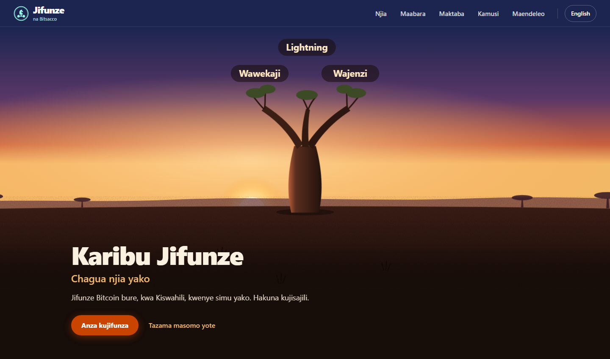
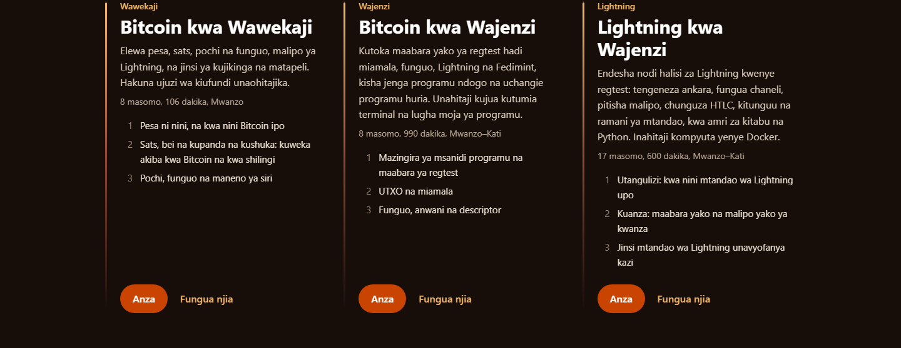
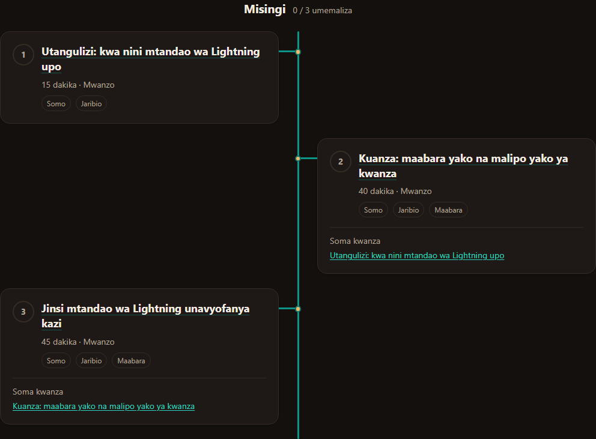

# Bitsacco Jifunze

Bitsacco Jifunze is a Kiswahili-first, bilingual Bitcoin education platform. Learn at **[bitsaccojifunze.xyz](https://bitsaccojifunze.xyz)** without an account.



## Learning paths

- **Bitcoin kwa Wawekaji / Bitcoin for Savers — 8 lessons:** Bitcoin basics, wallets, custody, payments and safety for everyday learners and savings groups.
- **Bitcoin kwa Wajenzi / Bitcoin for Builders — 8 lessons:** regtest, transactions, keys, Lightning, Fedimint and contributing to open-source projects.
- **Lightning kwa Wajenzi / Lightning for Builders — 17 lessons:** adapted from *Mastering the Lightning Network*, with interactive exercises.

Lessons are available in Kiswahili and English, with learning trees, quizzes, a glossary and Bitcoin simulations. The educational library includes the whitepaper in both languages and an in-app English *Mastering Bitcoin*, third-edition PDF reader and download. The Kiswahili book awaits official publication.

Learning progress stays in the browser and can be exported and imported. Previously opened lessons support offline reading; interactive simulations work offline after their modules have been loaded. The book is downloaded only on request and is not included in the offline lesson cache.

<details>
<summary>Preview the learning paths and Lightning tree</summary>

**Three learning paths in Kiswahili**



**Lightning learning tree**



</details>

## Interactive Lightning lab

The implemented lab runs isolated Bitcoin/Lightning **regtest** nodes using Docker. Learners run CLI commands and Python exercises from the Jifunze interface, using their own local or remote-development environment. It has been demonstrated with WSL2 and Docker; it uses no real funds and is not a shared Railway service. See [installation and connection instructions](lab/README.md).

## Local development

Use Node.js **24.20.0 or newer within Node 24**, and npm **12.0.2 or newer** (CI pins npm 12.0.2).

```bash
git clone https://github.com/comwanga/bitsacco-jifunze.git
cd bitsacco-jifunze
npm ci
npm run dev                 # http://localhost:3000/sw/
```

The site uses Next.js static export, React, TypeScript and build-time MDX. To validate changes:

```bash
npm ci --prefix api         # repository check dependencies; does not start the API
npm run check               # lint, types, unit tests, content validation
npm run build               # out/: CSP, internal links, PDF integrity and size budgets
npm run check:ux-budget     # per-page JavaScript budgets, after building
npx playwright install chromium webkit
npm run e2e                # browser, offline, accessibility and interaction checks
```

On Linux, Playwright may need `npx playwright install --with-deps chromium webkit`. Run resource-intensive suites sequentially. Browser tests use the static export, not the development server. Public learning requires no backend; the optional [account development stack](docs/development/accounts.md) is separate from production.

## Contributing

Educators can improve explanations and quizzes, translators can maintain bilingual lessons and terminology, and developers can fix issues or improve the platform and lab. Start with [CONTRIBUTING.md](CONTRIBUTING.md) and submit changes to [comwanga/bitsacco-jifunze](https://github.com/comwanga/bitsacco-jifunze).

Maintainer Kiswahili review is complete. Independent human technical-content sign-off remains outstanding before a public-launch announcement; automated tests do not replace that review.

## Documentation and licences

- [Documentation index](docs/README.md): current guides and clearly marked historical records.
- [Production operations](docs/deployment/production.md): Railway, domain, deployment, rollback, monitoring and scaling.
- [Staging safeguards](docs/deployment/railway-staging.md) and [Lightning lab](lab/README.md).
- [Account development and logs](docs/development/accounts.md): retained local stack and security requirements.
- [Book provenance and reproduction](docs/deployment/mastering-bitcoin-generated.md).
- Code: [MIT](LICENSE). Curriculum: [CC BY-SA 4.0](content/LICENSE). Adapted works and separate notices: [ATTRIBUTIONS.md](ATTRIBUTIONS.md).
