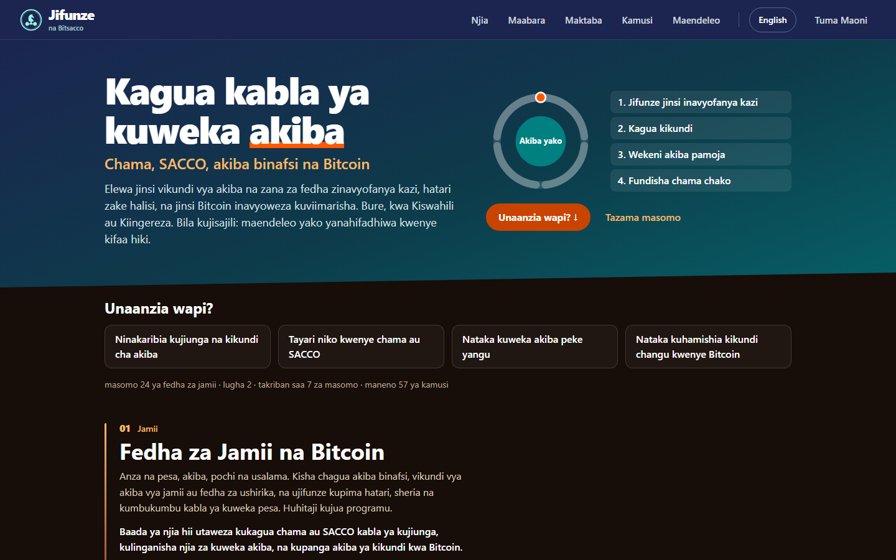
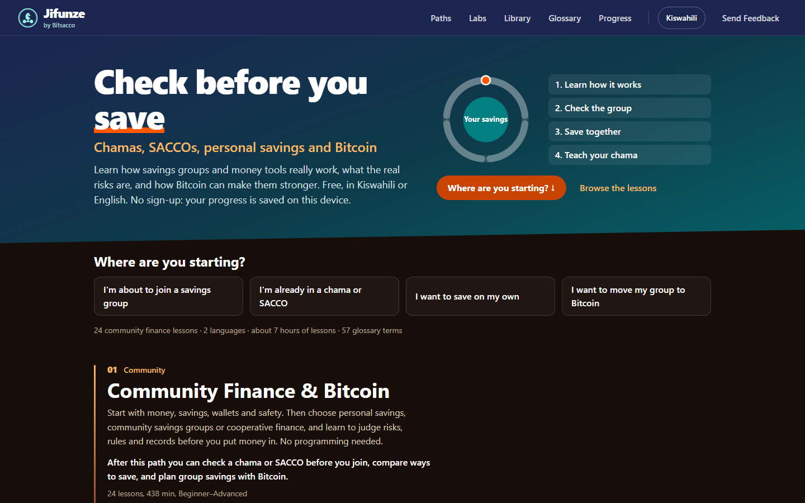
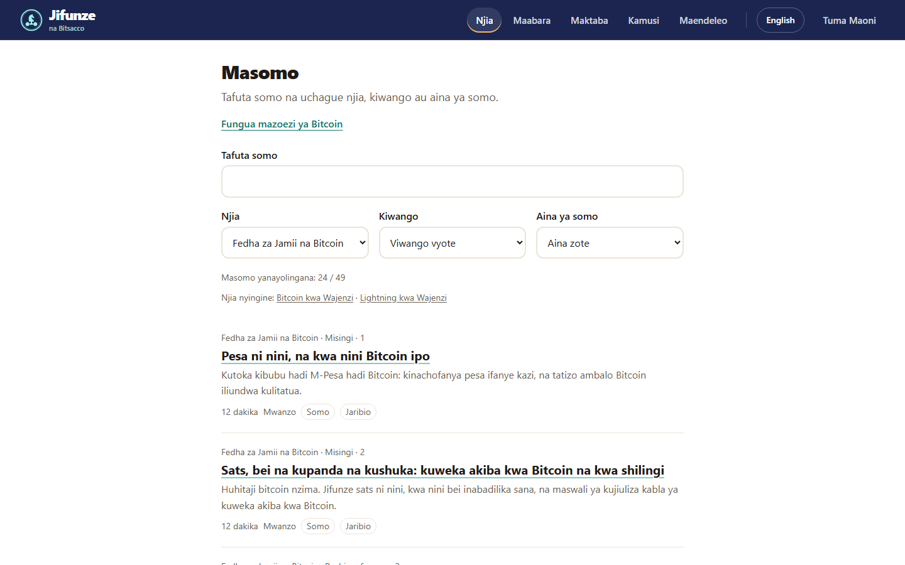
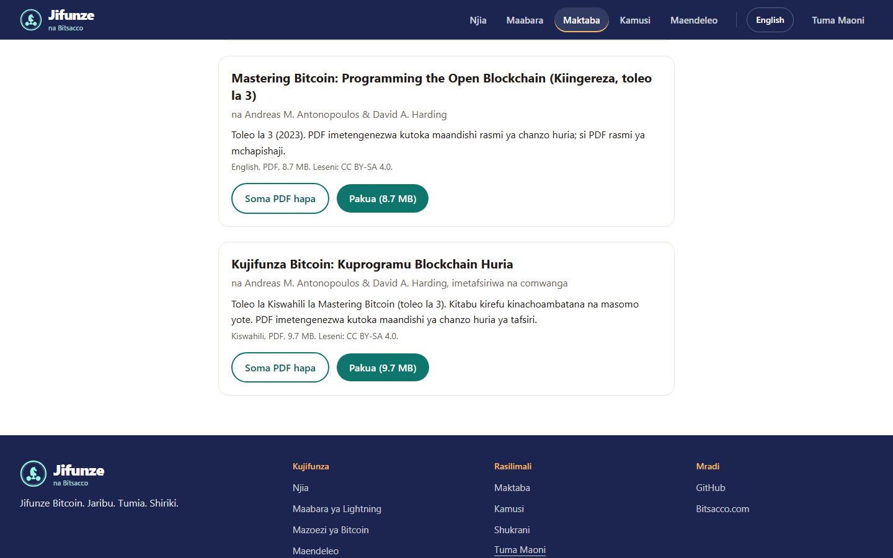
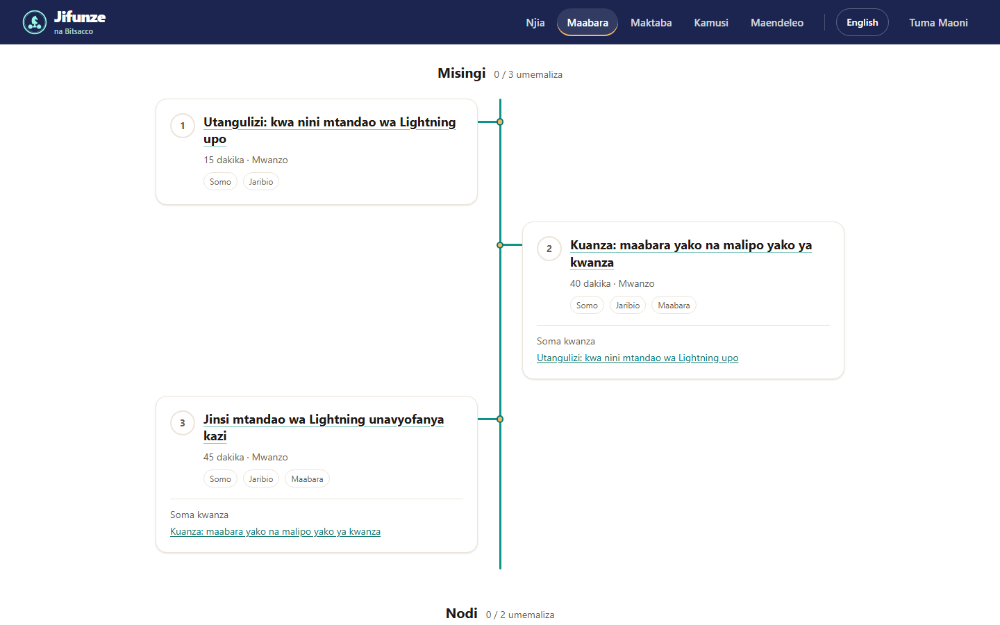

# Bitsacco Jifunze

Bitsacco Jifunze is a Kiswahili-first, bilingual community-finance and Bitcoin education platform: understand chamas, SACCOs and personal savings before you put money in, and how Bitcoin can strengthen them. Learn at **[bitsaccojifunze.xyz](https://bitsaccojifunze.xyz)** without an account.





## Learning paths

- **Fedha za Jamii na Bitcoin / Community Finance & Bitcoin — the main path, 8 introductory lessons + 16 specialization lessons (about 7 hours):** start with money, wallets and safety, then choose individual savings/financial sovereignty, community savings or cooperative finance, progressing through foundations, intermediate practice and advanced cases.

Two optional technical paths serve builders:

- **Bitcoin kwa Wajenzi / Bitcoin for Builders — 8 lessons:** regtest, transactions, keys, Lightning, Fedimint and contributing to open-source projects.
- **Lightning kwa Wajenzi / Lightning for Builders — 17 lessons:** adapted from *Mastering the Lightning Network*, with interactive exercises.

All 49 lessons are available in Kiswahili and English, with learning trees, quizzes, a glossary and fictional practice simulations. Every lesson includes required open-ended discussion: explain reasoning, test an assumption and formulate a question of your own. Learners self-confirm the activity before new lesson completion; answers stay with learners and existing completions remain valid. The owner's educational review and release decisions are linked under Contributing below.

The educational library includes the whitepaper in both languages and in-app readers and downloads for *Mastering Bitcoin*, third edition, in English and in Kiswahili (*Kujifunza Bitcoin*, translated by comwanga). See the [curriculum, primary sources and review guide](docs/content-guide.md).

There is no sign-up: learning progress is saved on the learner's device and can be exported and imported to move it to another one. Previously opened lessons support offline reading; interactive simulations work offline after their modules have been loaded. The books are downloaded only on request and are not included in the offline lesson cache.

**Send Feedback / Tuma Maoni** opens the learner's email application. It is a plain email link in the header, footer and beside learning material. Lesson feedback includes the public lesson title and address.

<details>
<summary>Preview the catalogue, library and Lightning tree</summary>

Screenshots of the build from [PR #34](https://github.com/comwanga/bitsacco-jifunze/pull/34), taken on staging on 26 November 2026.

**Lesson catalogue**, opening on the Community Finance path with links to the other paths



**Library** with both editions of *Mastering Bitcoin*, each with a reader and a download



**Lightning learning tree**



</details>

## Interactive Lightning lab

The implemented lab runs isolated Bitcoin/Lightning **regtest** nodes using Docker. Learners run CLI commands and Python exercises from the Jifunze interface, using their own local or remote-development environment. It has been demonstrated with WSL2 and Docker; it uses no real funds and is not a shared Railway service. See [installation and connection instructions](lab/README.md).

## Local development

Use Node.js **24.20.0 or newer within Node 24**, and npm **12.0.2 or newer** (CI pins npm 12.0.2).

```bash
git clone https://github.com/comwanga/bitsacco-jifunze.git
cd bitsacco-jifunze
npm ci
npm run dev                 # http://localhost:3000/sw/
```

The site uses Next.js static export, React, TypeScript and build-time MDX. To validate changes:

```bash
npm ci --prefix api         # repository check dependencies; does not start the API
npm run check               # lint, types, unit tests, content validation
npm run build               # out/: CSP, internal links, PDF integrity and size budgets
npm run check:ux-budget     # per-page JavaScript budgets, after building
npx playwright install chromium webkit
npm run e2e                # browser, offline, accessibility and interaction checks
```

On Linux, Playwright may need `npx playwright install --with-deps chromium webkit`. Run resource-intensive suites sequentially. Browser tests use the static export, not the development server. Public learning requires no backend. The unused API remains separately checked in CI; its [maintenance and security notes](docs/development/retained-api.md) describe that retained code.

## Contributing

Educators can improve explanations and quizzes, translators can maintain bilingual lessons and terminology, and developers can fix issues or improve the platform and lab. Start with [CONTRIBUTING.md](CONTRIBUTING.md) and submit changes to [comwanga/bitsacco-jifunze](https://github.com/comwanga/bitsacco-jifunze).

The project owner reviews lessons as they are produced; see [Contributing](CONTRIBUTING.md#reviewers) and the [review status](docs/content-guide.md#review-status).

## Documentation and licences

- [Documentation index](docs/README.md): current operating, content and development guides.
- [Production operations](docs/deployment/production.md): Railway, domain, deployment, rollback, monitoring and scaling.
- [Staging safeguards](docs/deployment/railway-staging.md) and [Lightning lab](lab/README.md).
- [Feedback](docs/development/feedback.md) and [curriculum/content review](docs/content-guide.md).
- Book provenance and reproduction: [English](docs/deployment/mastering-bitcoin-generated.md) and [Kiswahili](docs/deployment/kujifunza-bitcoin-generated.md).
- Code: [MIT](LICENSE). Curriculum: [CC BY-SA 4.0](content/LICENSE). Adapted works and separate notices: [ATTRIBUTIONS.md](ATTRIBUTIONS.md).
