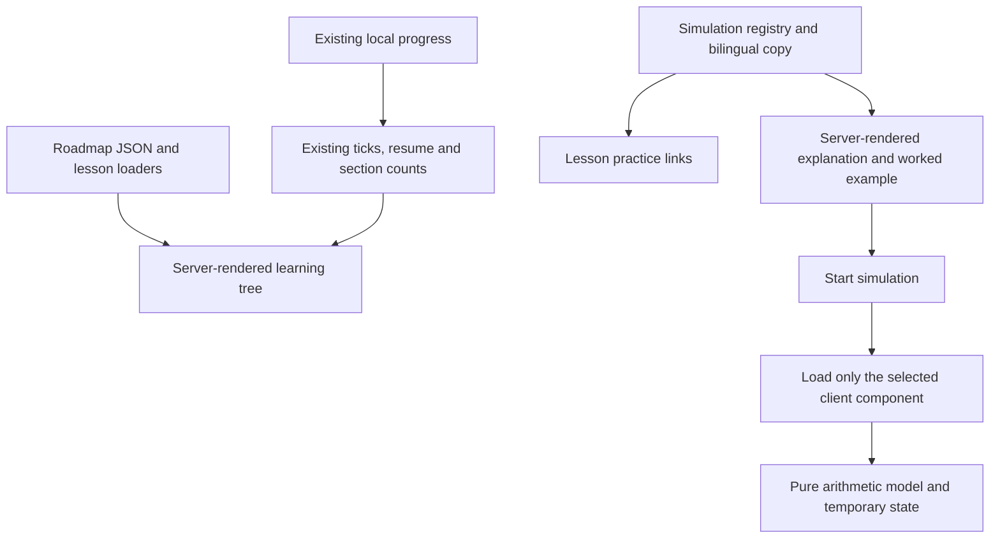

# UX Phase 2: learning trees and practice simulations

> **Historical phase record.** Decisions, proposals, hostnames, pending gates and results below describe this dated phase, not current operating instructions. See [current guides](../../README.md).

2026-11-03 · implementation scope approved by the maintainer · base `1a1ad0d291e949c1a70748022e9ac36149977a15`

This is the next **UX** phase. The older v1 spec uses “Phase 2” for accounts, synced progress, certificates and chama cohorts; those are a separate product scope. The maintainer asked to proceed with designing the learning tree and simulations after Phase 1.

## Outcome

A learner can see how a path is organised, open any lesson from a visual tree, and practise two concepts on a phone without setting up Docker. The existing catalogue, lesson reader, quizzes and live lab continue to work.

The approved simulations are **UTXO transactions** and **Lightning channel balances**. Routing remains outside this phase.

## Scope

| Feature | Included |
| --- | --- |
| Learning tree | All three existing paths, using their sections, lesson order and prerequisites |
| Practice simulations | UTXO inputs/change/fees; two-party Lightning channel balances |
| Languages | Kiswahili and English, including errors, examples and accessible labels |
| Devices | Keyboard, touch and 360 px phones; no hover-only or drag-only controls |
| Deployment | Static export; no new runtime dependencies |
| Progress | Reuse existing lesson completion; simulation state lasts only while its page is open |

Accounts, identity providers, backend services, certificates, cohorts, rewards, new course content and a Lightning routing/HTLC simulator are outside this draft. Simulations do not mark lessons or live lab exercises complete.

## Learning tree

### Routes and discovery

Add `/{lang}/tree/{roadmap}/` for each existing roadmap: six new pages. On both the existing roadmap and its tree, show a “List / Tree” navigation pair with `aria-current="page"`. The home page's Open path link continues to open the roadmap, where the alternative view is visible.

The catalogue remains the place to search every lesson. It does not gain a second filter system or a new top-level header item. The tree's header reuses the path title, description, lesson count, minutes, completion and Start/Continue/Review link.

### Appearance and semantics

Render the tree as semantic section headings and ordered lesson links. A decorative trunk and short branches connect the lesson cards using CSS. At wide widths, cards alternate beside the trunk in the same DOM and reading order. At narrow widths, the trunk moves to the left and cards use one column. Long translated titles wrap without clipping.

Each card shows the existing lesson number or completion tick, title, minutes and lesson-type badges. Sections show their existing completed/total count. Every lesson is present in server-rendered HTML, including when JavaScript is disabled or storage is unavailable.

The tree shows **course progression**, not a claim that prerequisites form a single-parent tree. Multiple prerequisites are ordinary “Read first” lesson links on a card, with their titles from the same content loaders. They remain guidance and never lock a lesson. Branches are decorative, hidden from assistive technology, and do not introduce a second set of links. Use native navigation semantics rather than the ARIA `tree` widget role.

No graph library, canvas, pan/zoom surface, force layout or automatic scrolling. No growth animation is required. The same content remains visible with reduced motion.

## Simulations

### Routes and lesson entry points

Add a server-rendered index at `/{lang}/simulations/` and details at `/{lang}/simulations/utxo/` and `/{lang}/simulations/channel-balances/`: six pages in the two languages.

Each detail page contains a title, short explanation, worked example, model limitations and related lesson links in its initial HTML. A “Start simulation” button loads the interactive component only after activation. Before hydration it is disabled; with JavaScript disabled a localized note points to the worked example. A loading state and retry button handle a failed chunk load without removing the explanation.

Add a small server-rendered practice link block to these existing lesson pages, through a central registry rather than copied MDX:

| Simulation | Related lessons |
| --- | --- |
| UTXO | `builders/utxos-transactions` |
| Channel balances | `savers/lightning-payments`, `builders/lightning-basics`, `lightning/payment-channels` |

The catalogue gets a single link to the simulations index. The interactive code is not embedded in lesson pages. These links use `prefetch={false}` so reading a lesson does not fetch a simulator. The existing Lightning exercises remain the next step for testing real regtest node behaviour.

### UTXO transaction model

The learner selects example coins with checkboxes and sets a recipient amount and an explicit example fee, all in whole sats. A preview shows selected inputs, the recipient output, any change output, and the fee. “Build example transaction” consumes the selected example coins and creates spendable change in the model; recipient outputs belong to the recipient. A short history and Reset make successive transactions understandable.

Start with coins of **6,000**, **4,000** and **2,000** sats. Paying **7,000** with a **500** sat fee using the first two coins creates **2,500** sats change. Selecting only 6,000 is insufficient. Selecting 6,000 + 2,000 for a 7,500 payment and 500 fee uses exact funding and creates no change output.

Pure model rules:

- Coin IDs must exist, be unspent and be selected only once. Inputs and calculations use safe integers, never floating-point BTC.
- Payment is a positive integer; example fee is a nonnegative integer. Reject blank, fractional, negative, non-finite and unsafe values rather than silently truncating them.
- `change = selected inputs - payment - fee`; reject negative change with no state change. Omit a zero change output.
- A consumed coin cannot be reused; change has a new deterministic ID. Unselected coins remain available.
- Across the model history, initial coins equal remaining learner coins plus recipient payments plus fees. Reset restores the original state.

Label this an arithmetic practice model. It does not create keys, addresses, scripts, signatures, transaction bytes or network broadcasts, and does not estimate real fees or validate dust/relay policy. A zero example fee is a valid arithmetic exercise, not a promise that a node will relay it.

### Lightning channel balance model

Show Alice and Bob with a shared **100,000** sat example capacity: Alice owns **70,000** and Bob **30,000**. Controls choose the payment direction and a positive whole-sat amount. “Make example payment” updates the two labelled balances and a visual bar; Reset restores the start. Text totals, direction labels and a history communicate every change without relying on colour or motion.

An Alice-to-Bob payment of **21,000** produces **49,000 / 51,000**. Bob then sending **10,000** back produces **59,000 / 41,000**. A payment larger than the sender's current model balance fails without changing either side. An exact-balance payment is allowed in this deliberately simplified model. Both balances stay nonnegative and their sum stays at capacity after every successful action.

The model represents already-settled payments between two participants. A short limitation note explains that actual spendable amounts also depend on channel reserves, fees and pending HTLCs; the practice model omits these constraints. It does not simulate commitment signing, revocation, timelocks, routing or live node connections. Label available amounts “in this example”, rather than presenting them as exact real-channel liquidity.

### Shared interaction and state

Use native labelled numeric inputs, checkboxes, radios and buttons. Keep invalid input visible, explain the specific error next to its field, and associate it through `aria-describedby`. Announce a concise result after an explicit action with `role="status"`; do not repeatedly announce decorative bar changes. Keep focus stable after actions and Reset.

No drag requirement, autoplay or essential animation. Simulation state is in React memory only, so refresh resets it. Opening or finishing a simulation never writes to `jifunze:progress:v1`. Language switching preserves the simulation route and starts its localized example again.

## Architecture and content

- `lib/content/tree.ts` builds tree data from existing loaders and `buildCatalog`; it never creates a second lesson-order source. Unknown roadmap IDs and registry lesson targets fail validation.
- `lib/simulations/registry.ts` defines the two IDs, localized metadata and related lesson keys. Keep filesystem validation server-only and client imports type-only where appropriate.
- `lib/simulations/utxo.ts` and `channel.ts` contain deterministic pure transitions, without React, storage or network access. Return explicit success/error results.
- Server-rendered page shells supply the explanation and worked example. A small client loader uses interaction-triggered imports with explicit module paths; the two simulation components are separate chunks.
- Put the few shared navigation labels in `lib/i18n.ts`. Keep the longer simulation instructions and feedback in a dedicated, typed bilingual `lib/simulations/copy.ts`, selecting only the current language for component props. This avoids adding every simulation string to existing client bundles. Add parity tests for this feature dictionary as well as the existing global dictionary.
- Tree headings and metadata use existing translated lesson/path content. New explanatory copy uses the established glossary vocabulary and is original; external technical sources are linked for further reading.
- Register all new routes in the sitemap with language alternatives. Expect **96 localized pages** for this two-simulation scope; derive expectations from route sources instead of scattering literal counts through tests.

## Offline, accessibility and performance

Keep current CSP permissions: simulations require no bridge, external connection, `eval` or third-party asset. Existing service-worker handling of known `/_next/static/` chunks supports an activated simulation after it has been loaded. Merely reading its explanation does not promise the interactive chunk is cached. Test both cases: offline reading before activation, and offline Reset/action/reload after activation; a missing chunk must show retry/help rather than break the page.

There must be no serious or critical axe findings on tree, simulation index, initial detail page, active simulation or error state in either language. Check 360 px overflow, keyboard interaction, dark mode and reduced motion. A tree remains navigable without JavaScript. A simulation retains a useful worked example without it.

Preserve the Phase 1 caps for existing pages, including shared-dictionary effects: home 144.9 KB, catalogue 145.0 KB, roadmap 145.1 KB, ordinary lesson 147.3 KB and lab 153.2 KB gzip JavaScript. New tree pages use **145.1 KB**, the index/detail initial pages **145.0 KB**. After activation, a simulation's total unique downloaded JavaScript must stay within **150 KB gzip**, with its extra simulation chunks within **6 KB gzip**. These are design acceptance targets, not measured results. If a target fails, reduce/split the feature before changing a budget.

`pageWeight` checks initial HTML script references, so it cannot alone prove the activated budget. Browser budget checks must record unique script requests through activation, map local asset URLs back to `out/`, and sum gzip sizes, counting each asset once. Both languages and both simulation IDs are covered.

## Delivery and review

The completed implementation is recorded in the [implementation report](../reports/2026-11-03-phase-2-ux-implementation.md). The original delivery order was: data contracts, tree, shared simulation shell, UTXO, channel balances, lesson discovery, final verification. Use signed commits without co-author trailers. Phase 1 PR #2 was verified merged at `1a1ad0d291e949c1a70748022e9ac36149977a15`; implementation starts from updated main on `feat/phase-2-ux`. Keep work local until publication is explicitly authorized.

Success means a learner can find any lesson from a readable tree, demonstrate where change comes from, and explain why a two-party channel has a direction-dependent payment limit. Real-world protocol edge cases remain in the linked lessons and live lab.

## Technical references checked for this design

- [Bitcoin Developer Guide: transaction inputs, outputs, fees and change](https://developer.bitcoin.org/devguide/transactions.html). Used for the accounting relationship; old fee-policy examples on that page are not adopted.
- [Lightning Labs: understanding liquidity](https://docs.lightning.engineering/the-lightning-network/liquidity/understanding-liquidity). Used to distinguish channel balance illustrations from practical liquidity constraints.
- [BOLT 2: peer protocol for channel management](https://github.com/lightning/bolts/blob/master/02-peer-protocol.md). Used to identify omitted real-channel constraints such as reserves and HTLC limits; this draft does not implement the protocol.
